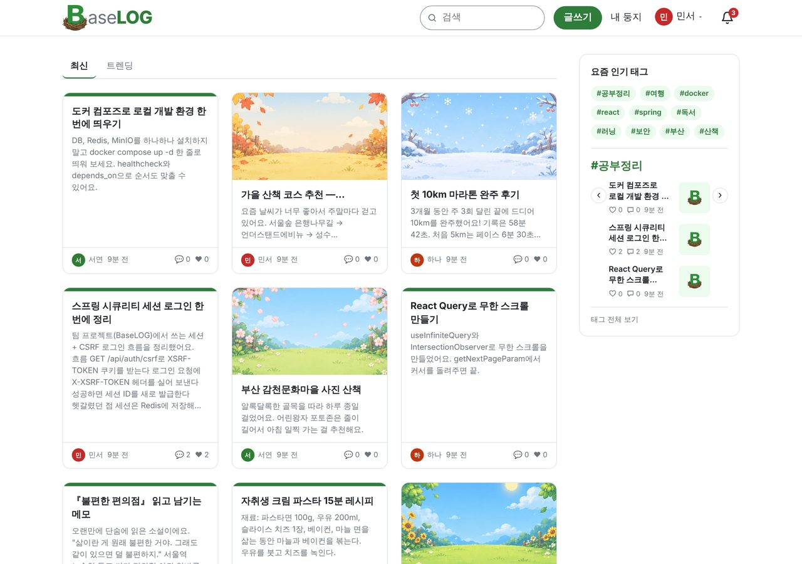
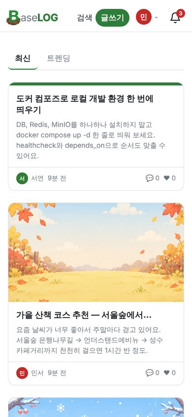
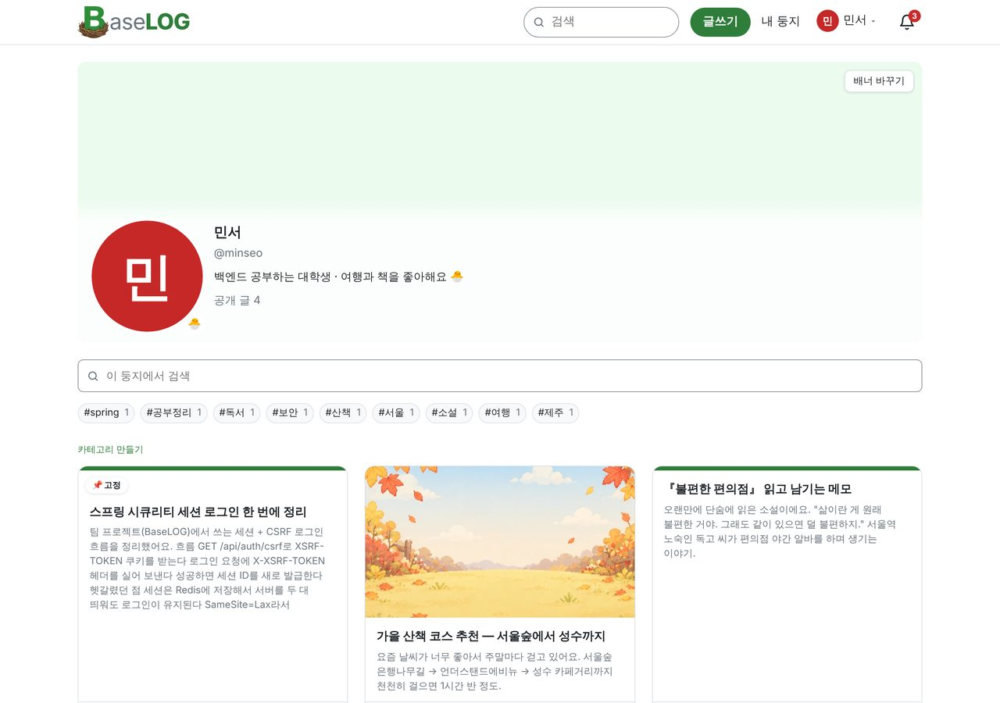
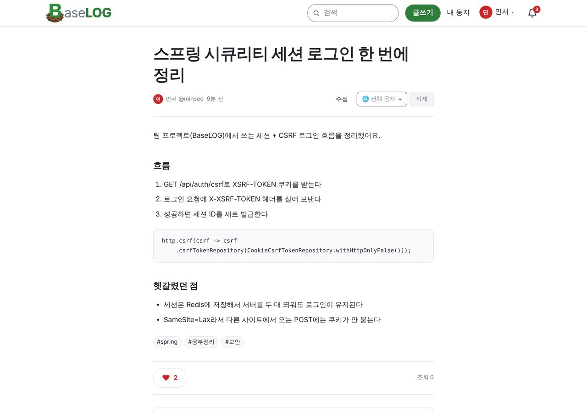
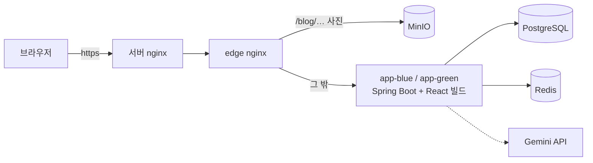
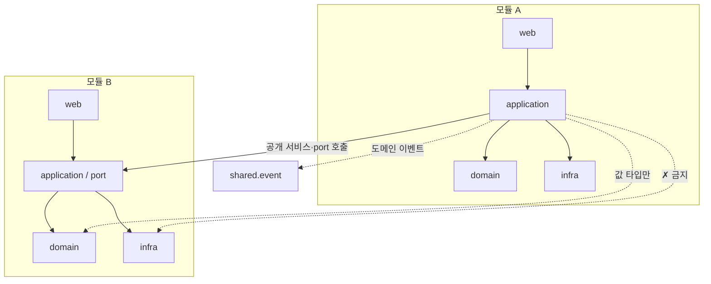

# BaseLOG

> 글을 쓰고, 친구와 나누고, 나만의 "둥지"를 꾸미는 개인 블로그 서비스

**사이트** https://baselog.java21.net · **설계 문서** [AIGJ006/BaseLOG_DOCS](https://github.com/AIGJ006/BaseLOG_DOCS) · **변경 기록** [CHANGELOG.md](CHANGELOG.md)

<p>
  
  
</p>

## 한눈에 보기

- **기간·인원**: 2026-10 ~ , 1인 개발 (팀 공통 설계인 공통 ERD·constitution 위에 개인 기능을 더하는 방식)
- **방식**: Spec Kit 스펙 주도 개발. 기능마다 spec → plan → tasks → 구현 순서로, 스펙 31개([specs/](https://github.com/AIGJ006/BaseLOG_DOCS/tree/main/specs))
- **운영**: 2026-10-10 첫 배포(1.0.0)부터 1.5.4까지 릴리스 17번, GitHub Actions로 main 머지 때 무중단 배포

## 주요 기능

| 영역 | 기능 |
|---|---|
| 글 | 자동 저장되는 글쓰기(마크다운·사진·첨부파일), 공개·친구 공개·나만 보기, 카테고리·태그, 휴지통, 둥지 맨 위 고정 글, 친구와 함께 쓰는 공동 작업 |
| 둥지 | 내 블로그 주소(`/@아이디`), 배너·사계절 배경, 하루 첫 방문 출석으로 새 키우기·장식 꾸미기, 둥지 방문자 통계 |
| 함께 | 친구(요청·수락), 친구 피드, 댓글·비밀 댓글·답글, 좋아요, 알림 |
| 찾기 | 최신·트렌딩 홈, 인기 태그, 검색(pg_trgm), 구글·네이버 검색 노출(사이트맵·메타) |
| 계정 | 이메일 6자리 코드 가입, Google·GitHub 로그인, 다크 모드 |
| AI | 글 태그 추천·맞춤법 검사(Gemini, 로컬은 Ollama) |
| 운영 | 신고·숨김·정지, 문의 답변, 관리자 통계, 사이트 공지·업데이트 소식 |

<p>
  
  
</p>

## 기술 스택

| 영역 | 쓰는 것 |
|---|---|
| 백엔드 | Java 21, Spring Boot 4.1 (Web MVC, Security 세션 + OAuth2, Data JPA·JdbcClient, Validation, Mail) |
| 데이터 | PostgreSQL 18 + Flyway(추가만 하는 마이그레이션 V1~V24), Redis 7(세션·조회수·요청 제한·인기 글), MinIO(사진) |
| 화면 | React 18, TypeScript, Vite, React Router |
| 시험 | JUnit 5 + Testcontainers(실제 PostgreSQL·Redis), ArchUnit(모듈 경계), Vitest + Testing Library, Playwright |
| 배포 | Docker Compose, GitHub Actions, nginx edge, blue·green 무중단 배포, SonarQube·CodeRabbit 리뷰 |

## 설계

### 실행 구조



화면(React)은 빌드해서 Spring Boot가 같이 내보냅니다. 배포 때는 쉬고 있는 쪽(blue·green)에 새 버전을 띄워 응답을 확인한 뒤 edge가 보낼 곳만 바꿔서, 접속이 끊기지 않습니다. 자세한 건 [deploy/README.md](deploy/README.md).

### 모듈러 모놀리스

하나의 Spring Boot 앱 안을 기능별 모듈로 나눴습니다(`backend/src/main/java/com/team/blog/`).

`account` · `post` · `category` · `tag` · `media` · `interaction` · `discovery` · `notification` · `moderation` · `nest` · `stats` · `inquiry` · `spellcheck` · `shared`



- 다른 모듈은 `application`의 공개 서비스·`port`나 `shared.event`의 도메인 이벤트로만 부릅니다. 다른 모듈의 `infra`·`web`·`config`, 엔티티·저장소는 쓰지 않습니다
- `shared`는 기능 모듈을 모르고, 필요한 기능은 포트(예: `AccountStatusGuard`, `MemberAccessLookup`)로 열어 두면 기능 모듈이 구현합니다
- 이 규칙은 [`ModuleBoundaryTest`](backend/src/test/java/com/team/blog/ModuleBoundaryTest.java)(ArchUnit)가 빌드마다 확인해서, 어기면 CI가 빨갛게 됩니다

### 데이터

테이블 31개. 전체 관계와 모듈별 ERD는 [53-erd-current.md](https://github.com/AIGJ006/BaseLOG_DOCS/blob/main/docs/53-erd-current.md)에 있습니다. 마이그레이션은 공통 ERD를 바꾸지 않고 새 테이블·nullable 칸만 더하는 원칙(constitution I)으로 쌓았습니다. 그래서 blue·green 전환 중 옛 앱과 새 앱이 같은 DB를 잠깐 함께 써도 문제가 없습니다.

### 시험

- 백엔드: 서비스 단위 시험 + Testcontainers로 실제 PostgreSQL·Redis를 띄운 통합 시험, API 계약(openapi) 시험, 모듈 경계 시험
- 화면: 컴포넌트·화면 단위 시험(Vitest), 화면 코드에 색 값을 직접 쓰지 못하게 막는 시험(라이트·다크 토큰만 사용)
- PR마다 CI에서 바뀐 쪽만 돌리고, 초록이어야 머지합니다

## 문제를 풀었던 기록

| 문제 | 원인 | 해결 |
|---|---|---|
| 구글 로그인이 `redirect_uri_mismatch`로 막힘 | 클라우드플레어(https) 뒤의 서버 nginx가 80으로 받아 앱에 `http`를 넘겨서, 앱이 http 주소로 돌아올 곳을 만듦 | edge가 `X-Forwarded-Proto`를 사이트 주소의 스킴으로 고정 (#43) |
| 무중단 배포 중 새 앱 기동 확인이 실패 | nginx가 시작할 때 한 번 찾은 컨테이너 주소를 계속 써서, 다시 만든 앱 대신 옛 주소로 보냄 | 도커 내부 DNS로 다시 찾게 하고 배포 때 edge도 다시 띄움 (#37) |
| 서버 쪽 nginx가 바뀐 뒤 사이트 전체가 502 | 서버 nginx가 내부망 주소로 붙는데 edge는 127.0.0.1에만 열려 있었음 | 루프백은 두고 내부망 주소를 하나 더 열어 핫픽스 (#190) |
| 가입 코드를 동시에 여러 번 보내면 5번 제한을 넘김 | 비교·틀린 횟수 증가·삭제가 따로 실행됨 | Redis Lua 스크립트 하나로 묶어 원자 처리 |
| 모듈 경계가 주석으로만 있어 조금씩 무너짐 | 다른 모듈의 infra·저장소를 바로 가져다 씀 | 경계를 넘던 타입을 port·shared로 옮기고 ArchUnit 시험으로 고정 (#193) |

## 저장소 구성

스펙·설계 문서(원문 docs, 기능별 specs, constitution, Spec Kit 명령)는 **[AIGJ006/BaseLOG_DOCS](https://github.com/AIGJ006/BaseLOG_DOCS)** 에 있습니다. 코드 주석의 `docs/NN`, `specs/NNN-기능` 경로는 그 저장소 기준입니다.

| 경로 | 내용 |
|---|---|
| [`backend/`](backend/) | Spring Boot + PostgreSQL + Flyway (모듈러 모놀리스) |
| [`frontend/`](frontend/) | React 화면 |
| [`deploy/`](deploy/) | 팀 공용 서버 배포 설정과 [안내](deploy/README.md) |
| [`.github/workflows/`](.github/workflows/) | CI(PR마다 시험), main에 머지(릴리스)하면 서버로 무중단 자동 배포 (작업 흐름은 아래) |
| [`scripts/`](scripts/) | 테스트 계정·글 만들기 등 보조 스크립트 |
| `backend/src/test/resources/contracts/` | 테스트가 읽는 API 계약(openapi.yaml) 복사본. 문서 저장소의 계약을 바꾸면 여기도 같이 바꿉니다 |

## 내 컴퓨터에서 실행

```bash
cp .env.example .env      # 처음 한 번, 키 값 채우기
docker compose up -d --build
```

앱은 http://localhost:8080, 가입 인증 메일은 http://localhost:8025 (Mailpit)에서 봅니다. 끌 때는 `docker compose down`.

## 작업 흐름 (Git Flow)

Git Flow를 우리 배포 방식에 맞춰 씁니다. 자세한 개발 환경은 [DEVELOPMENT.md](DEVELOPMENT.md).

```
feature/*  ──PR──▶  dev  ──(평일 17:45 릴리스)──▶ release/vX.Y.Z ──PR──▶ main
                     ▲                                                  │
hotfix/*  ──PR──────┴──────────────────────────────────────────PR───────┘
```

| 브랜치 | 만드는 곳 | 합치는 곳 | 하는 일 |
|---|---|---|---|
| `main` | — | — | 실제 사이트에 올라간 버전. 릴리스 때만 바뀌고, **머지하면 실제 사이트에 무중단 배포**됩니다(시험은 PR에서 통과한 것으로 갈음) |
| `dev` | — | — | 개발 브랜치(Git Flow의 develop). 서버에는 올리지 않고 로컬에서 확인합니다([DEVELOPMENT.md](DEVELOPMENT.md)) |
| `feature/<이름>` | dev | dev (PR) | 기능·화면·버그 수정 하나. 예: `feature/friend-visibility` |
| `release/vX.Y.Z` | dev | main (PR) | 릴리스 노트(`frontend/src/features/site-news/releases/vX.Y.Z.md`)를 넣은 dev를 main에 올립니다. 머지 뒤 이 브랜치는 자동으로 지워집니다(그래서 dev를 직접 head로 쓰지 않습니다) |
| `hotfix/<이름>` | main | dev와 main (PR 두 개) | 사이트가 안 열리는 등 급한 고침 |

- **PR 규칙**: 모든 PR은 CI(`.github/workflows/ci.yml` — 백엔드 `./mvnw verify`, 화면 lint·test·build)가 초록이어야 머지합니다. 바뀐 쪽만 시험해요(화면만 바꾸면 백엔드 시험은 건너뜀).
- **버전**: 평소 수정은 끝자리(1.1.0 → 1.1.1), 큰 기능은 가운데 자리(1.1 → 1.2). 평일 17:45, 주말 수정분은 월요일에 묶습니다.
- **되돌리기**: main에서 문제의 릴리스 머지를 되돌리는(revert) PR을 머지하면 직전 버전으로 무중단 재배포됩니다. 이 변경 뒤에 만든 릴리스 태그(1.1.0 다음부터)는 Actions → deploy → Run workflow에서 태그를 골라 바로 다시 배포할 수도 있어요.

변경 기록은 [CHANGELOG.md](CHANGELOG.md)에 있습니다.
