<!-- target: 7356daed89872b4e1072d033d281579f31337c7a -->
<!-- title: BaseLOG 1.3.0 배포 이후 수정사항 -->
<!-- date: 2026-10-14 -->

### 가입·설정

- 회원 가입할 때 이메일로 받은 6자리 인증 코드를 넣어야 가입할 수 있어요. GitHub로 가입하면서 이메일을 직접 적을 때도 같아요 (#119)
  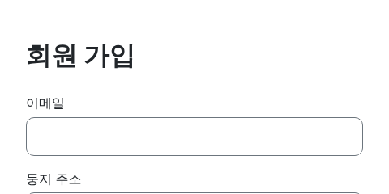 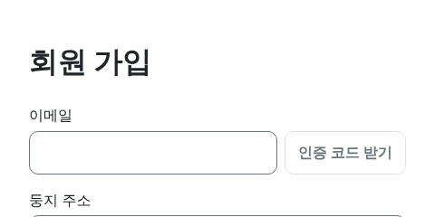
- 설정 화면을 왼쪽 탭(프로필·계정·화면·알림·이용약관)으로 나눴어요. 닉네임을 바꿀 때 조건과 사용 가능 여부가 바로 보여요 (#120)
  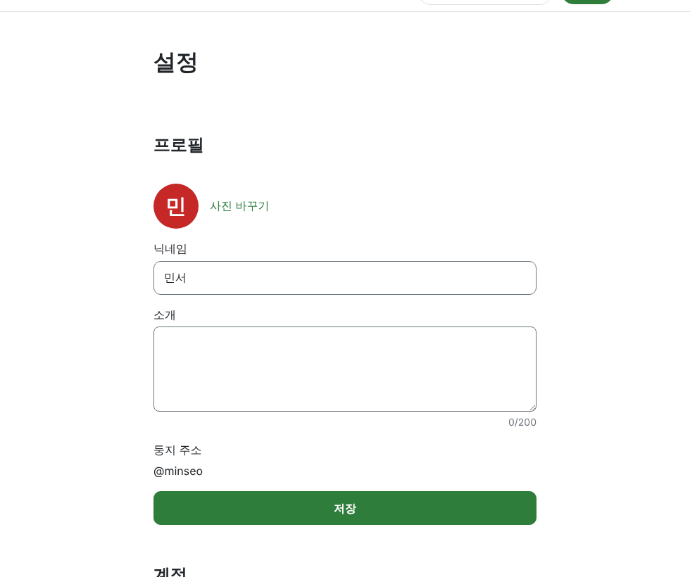 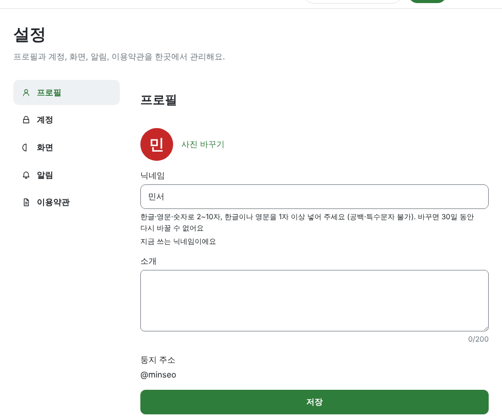

### 문의·신고

- 내 프로필 메뉴의 [문의·신고]에서 버그 신고, 계정 문의, 사용자 신고를 보낼 수 있어요. 관리자가 답하면 🔔 알림으로 알려 드려요 (#121)
  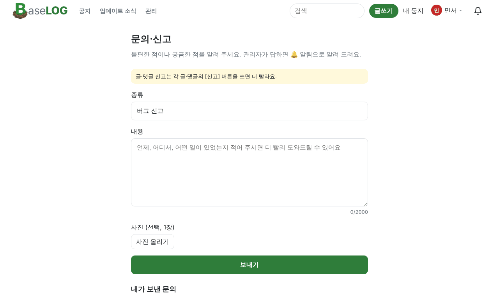

### 글

- 글쓰기 화면에 [맞춤법 검사] 버튼이 생겼어요. 누르면 틀린 곳에 빨간 밑줄이 생기고, 고칠 말을 골라 바꿀 수 있어요. 하루 30번까지 쓸 수 있어요 (#113)
  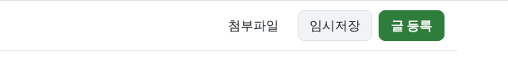 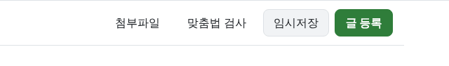
- 공개 범위 선택 칸 앞의 "공개 범위" 글자를 뺐어요 (#115)
  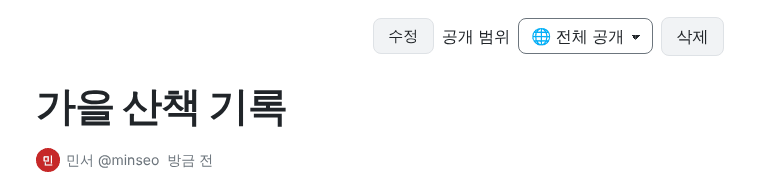 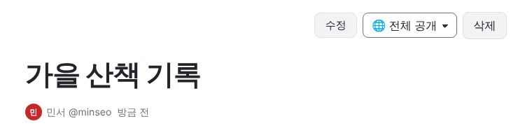

### 새 키우기

- 단풍 둥지(200점)가 새로 나왔어요 (#112)
  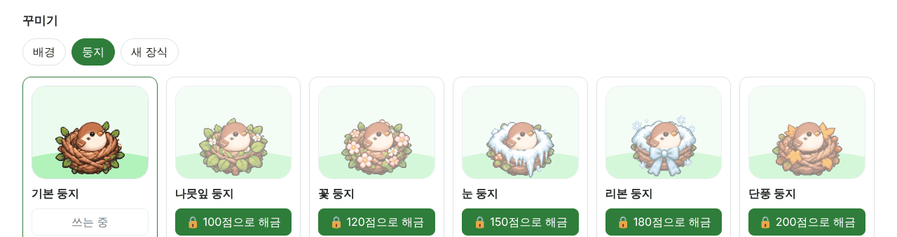
- 새 장식에 하트 선글라스와 픽셀 선글라스(각 150점)가 생겼어요 (#117)
  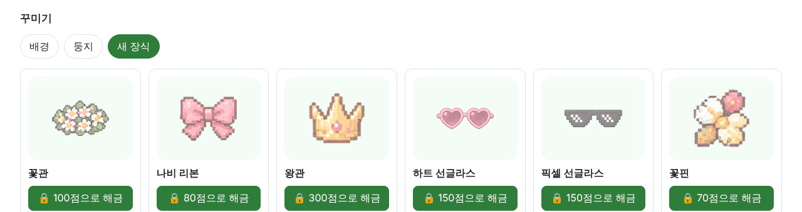
- 둥지 맨 위의 새 칸을 뺐어요. 출석은 전처럼 내 둥지에 들어오면 돼요 (#116)
  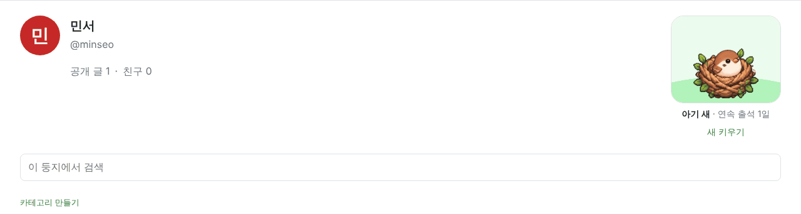 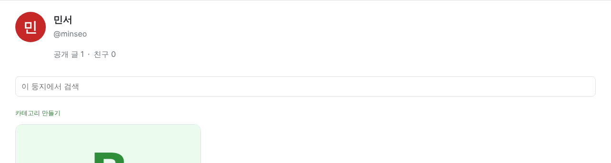

### 사이트

- 화면 맨 아래에 GitHub 링크와 이용약관이 생겼어요 (#118)
  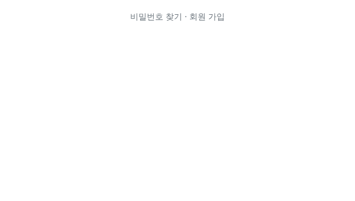 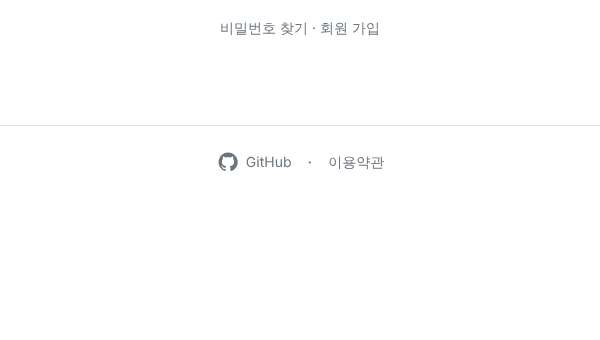
- 업데이트 소식에 바뀌기 전과 후 그림을 함께 보여 드려요 (#122)
