<!-- target: 7e41c269b524dd2f256767825984596afb1a5e95 -->
<!-- title: BaseLOG 1.4.0 배포 이후 수정사항 -->
<!-- date: 2026-10-15 -->

### 둥지

- 둥지 맨 위에 넓은 배너 사진을 걸 수 있어요. 설정 > 프로필에서 사진을 고르고 보일 부분을 잘라 정해요 (#133)
  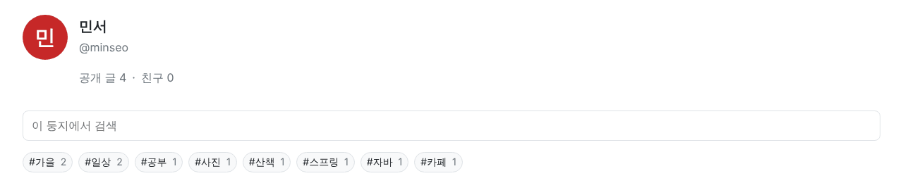 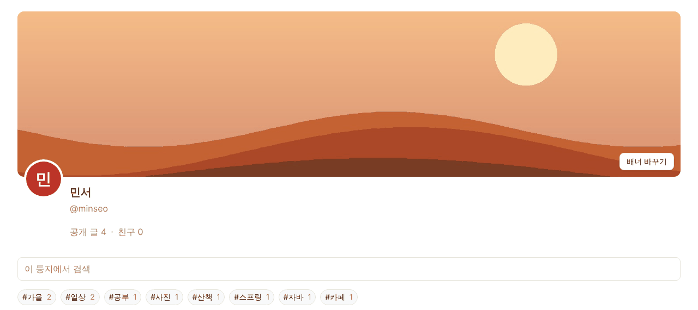
- 계정 메뉴의 [내 글 관리]가 [내 둥지 관리]로 바뀌었어요. 글·카테고리·통계·휴지통을 왼쪽 탭으로 한 화면에서 관리해요 (#134)
  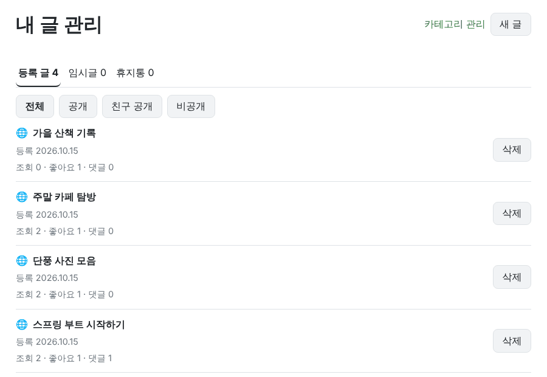 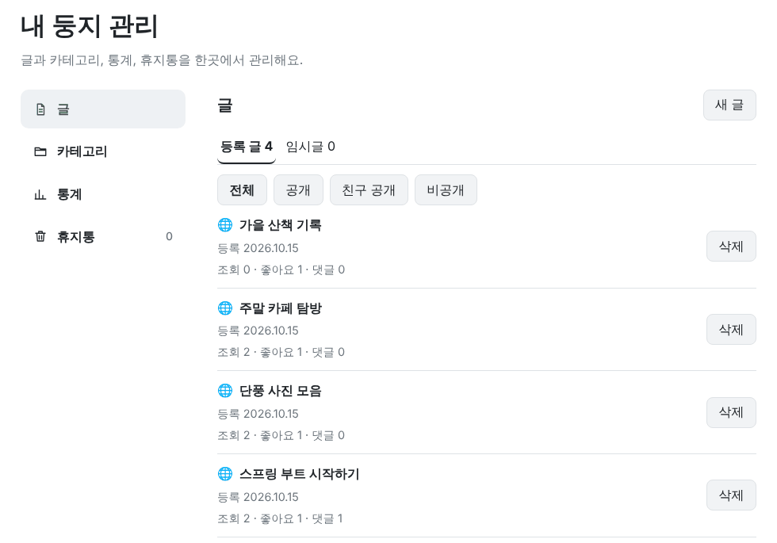
- [내 둥지 관리] > [통계]에서 내 글 조회수, 최근 30일 그래프, 받은 좋아요·댓글, 많이 본 글을 볼 수 있어요 (#134)
  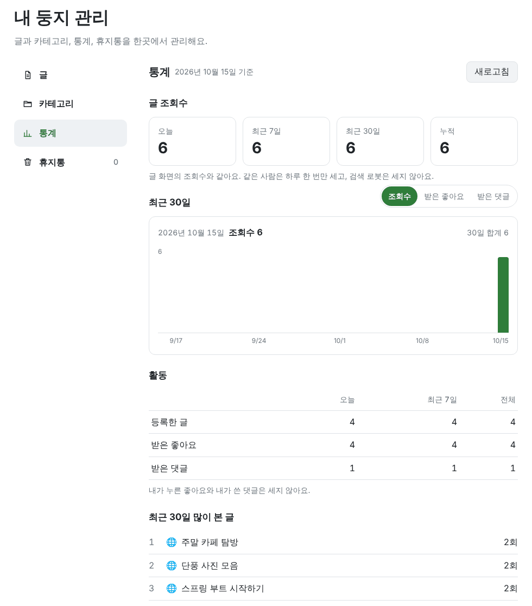

### 새 키우기

- 새 장식은 [착용]·[착용 해제], 배경·둥지는 [적용]·"적용 중"으로 단추 글자를 나눴어요. 포인트 기록은 처음 5개만 보이고 [더 보기]를 누르면 10개씩 더 나와요 (#126)
  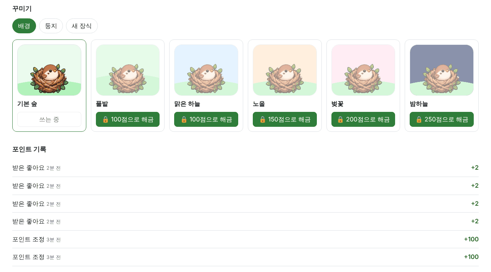 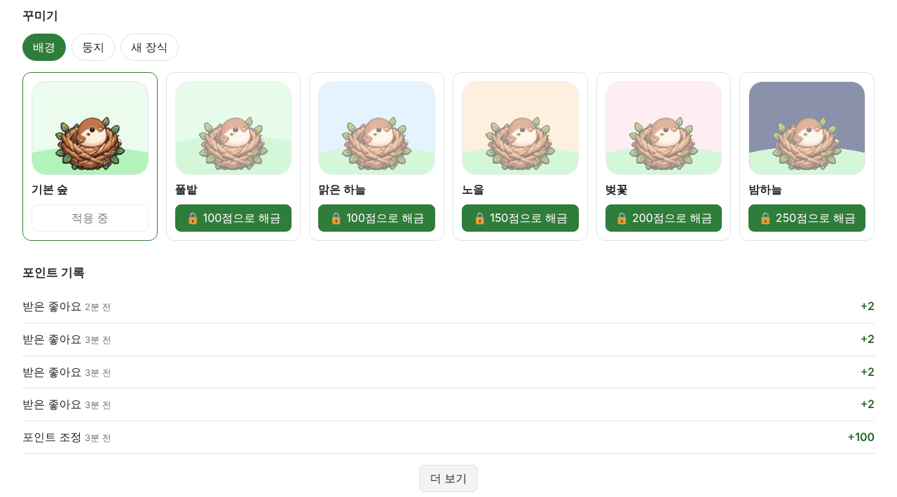

### 문의·신고

- [문의·신고] 화면을 [문의·신고하기]와 [내 문의·신고] 두 탭으로 나눴어요 (#137)
  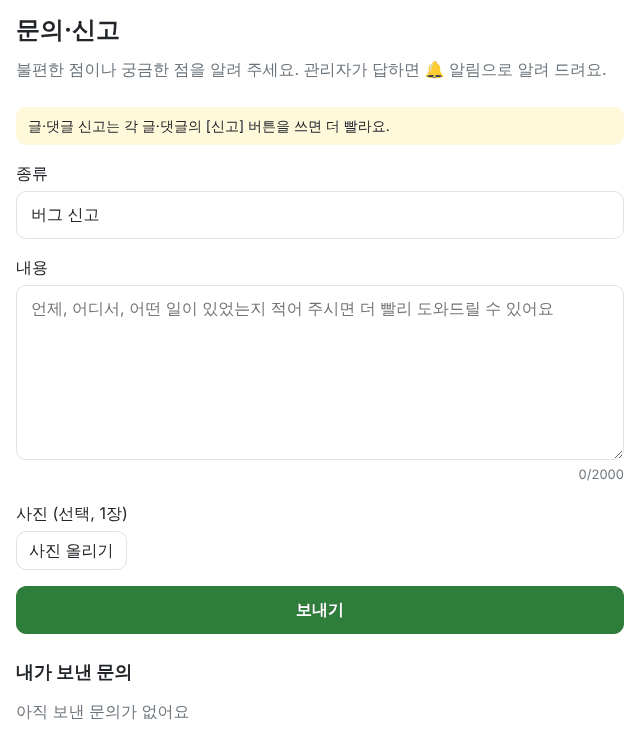 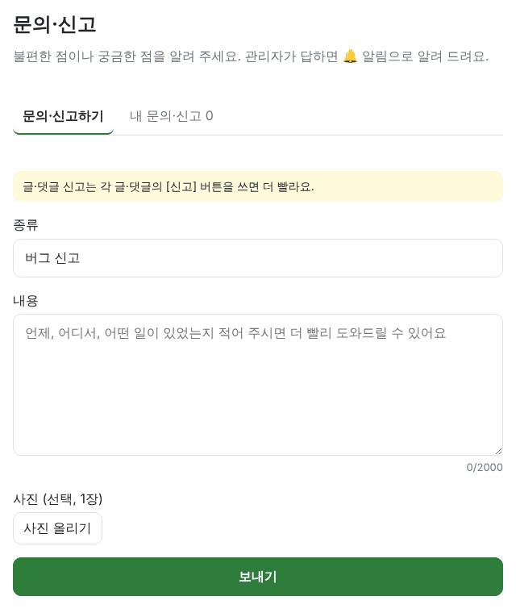

### 홈

- 요즘 인기 태그에서 태그를 넘겨도 ‹ › 화살표가 첫 글 줄에 그대로 있어요 (#138)
   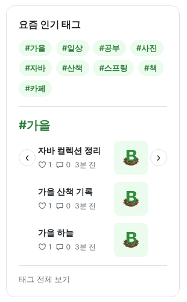

### 관리자

- 관리 화면에 [통계]가 생겼어요. 방문자(오늘·어제·7일·누적), 최근 30일 그래프, 새 회원·글·댓글·조회수, 최근 7일 많이 본 글을 봐요. 방문자는 이번 배포 날부터 세요 (#129)
  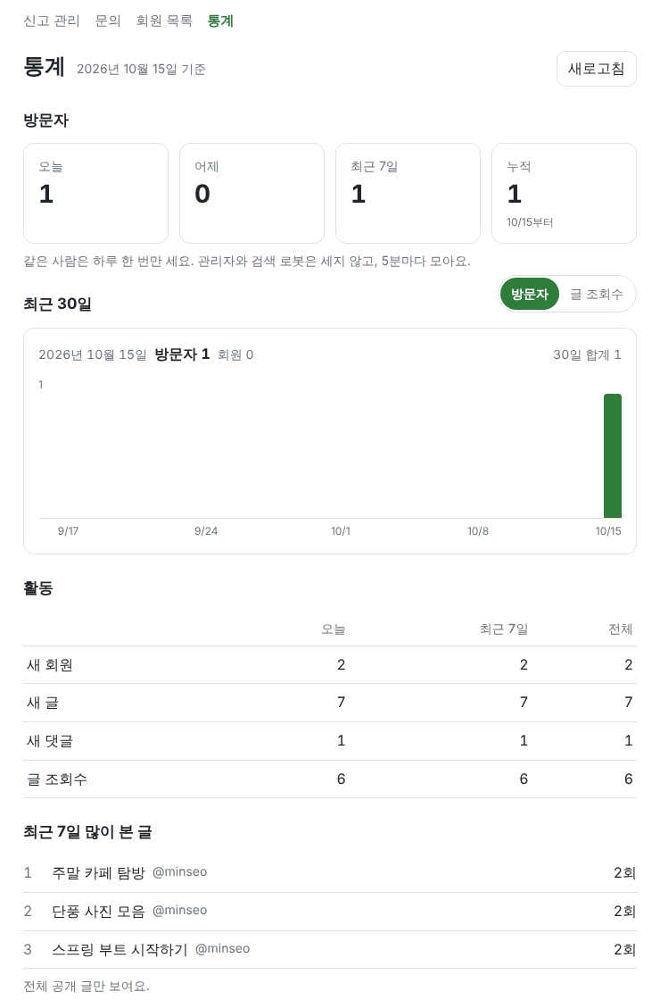
- [문의] 목록을 한 줄씩 짧게 보여 주고 전체·처리 전·처리 완료로 나눠 봐요. 누르면 문의 화면에서 답해요 (#137)
  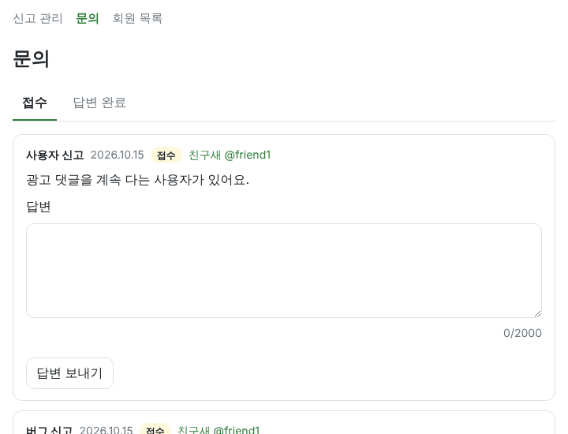 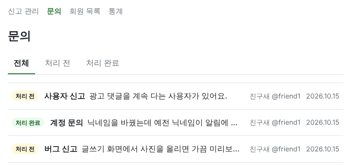

### 사이트

- 코드 검사(SonarQube)에서 나온 지적을 고쳤어요. 화면에서 달라지는 건 없어요 (#130, #131, #135, #136)
