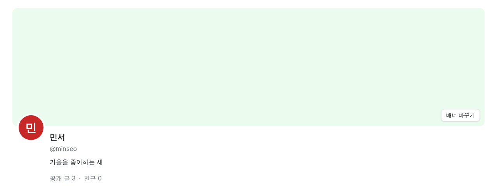
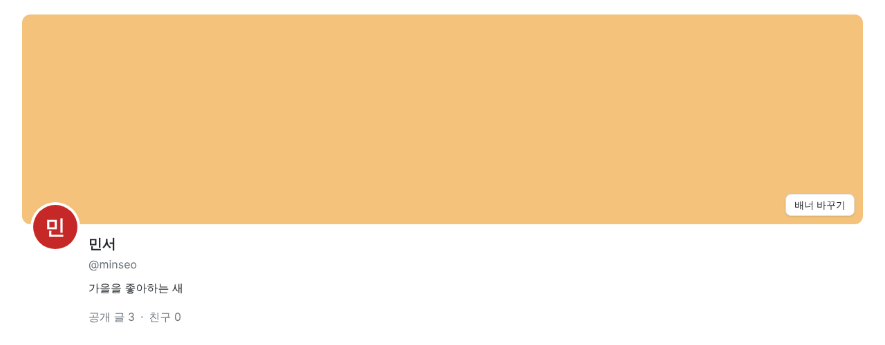
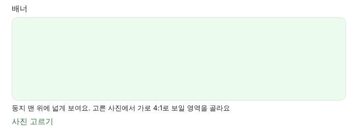
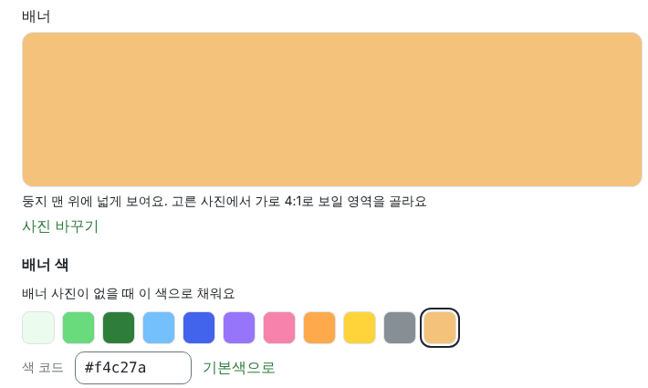
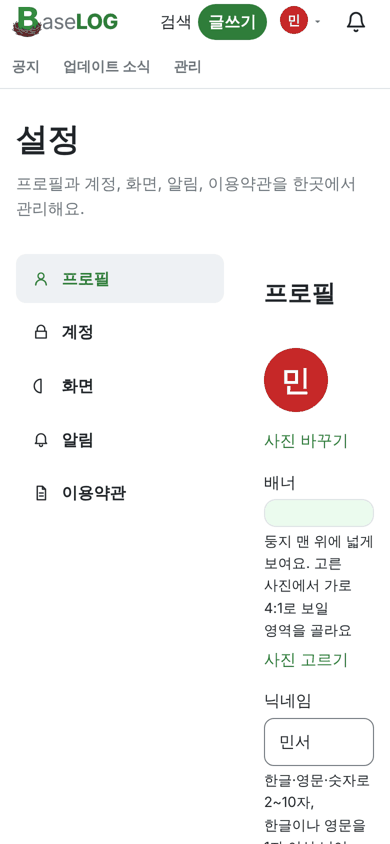
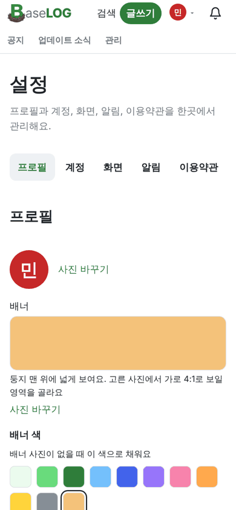

<!-- target: 5bcf5a57aebdc37556ca5d8092a5ef982b00cc3e -->
<!-- title: BaseLOG 1.4.1 배포 이후 수정사항 -->
<!-- date: 2026-10-15 -->

### 둥지

- 배너 사진이 없을 때 칠할 색을 고를 수 있어요. 설정 > 프로필의 [배너 색]에서 고르거나 색 코드를 넣어요 (#143)
   
- 설정의 배너 단추 글자를 프로필 사진과 같은 [사진 바꾸기]로 맞췄어요 (#141, #143)
   

### 설정

- 휴대폰에서 설정 탭이 위쪽 한 줄로 바뀌어 화면이 좁게 깨지지 않아요 (#141)
   
