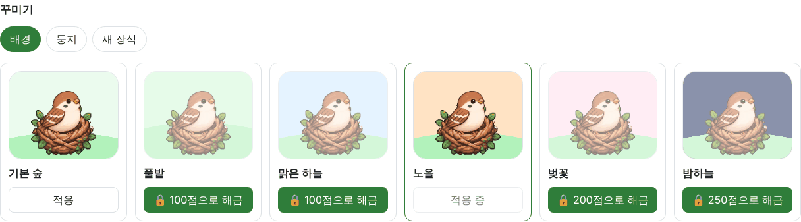
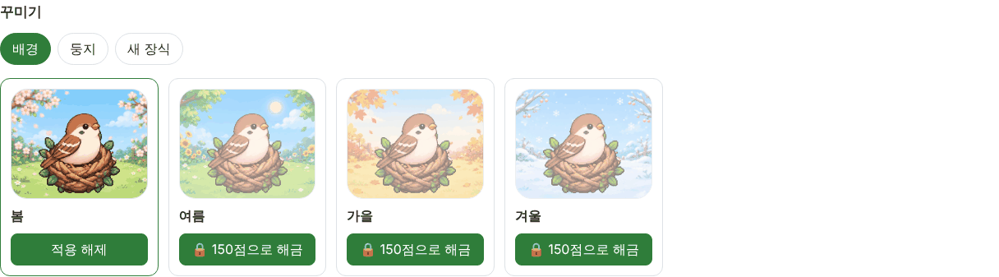
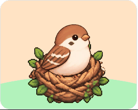
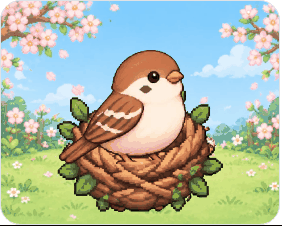
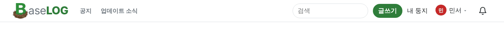
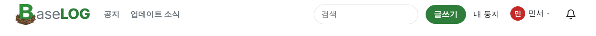

<!-- target: e25278ea0064798315b8150e2d3248c51fa289c2 -->
<!-- title: BaseLOG 1.4.2 배포 이후 수정사항 -->
<!-- date: 2026-10-16 -->

### 새 키우기

- 둥지 배경이 봄·여름·가을·겨울 그림 넷으로 바뀌었어요. 하나에 150점으로 사서 적용하고, 적용을 해제하면 기본 하늘색 배경으로 돌아가요 (#150)
   
   
- 예전 배경(풀밭·맑은 하늘·노을·벚꽃·밤하늘)은 없어졌어요. 샀던 배경 포인트는 포인트 기록에 "포인트 조정"으로 돌려드렸어요 (#150)
- 2단계부터 새 날개가 둥지에 가려지던 것을 고쳤어요 (#150)

### 사이트

- 머리말을 키웠어요. PC에서 높이와 로고·글자·검색칸·단추가 커지고, 휴대폰은 위아래 여백을 맞췄어요 (#149)
   

### 설정

- 배너 색 코드 칸을 비우면 기본색으로 돌아가요 (#151)
- 휴대폰에서 설정 탭을 키보드 왼쪽·오른쪽 방향키로 옮겨 다닐 수 있어요 (#151)

### 관리자

- 문의 상세에서 [목록으로]를 누르면 보던 상태(처리 전·완료) 목록으로 돌아가요 (#148)
- 자정을 넘겨 사이트를 계속 열어 둔 방문도 다음 날 방문자로 세요 (#148)
