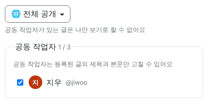
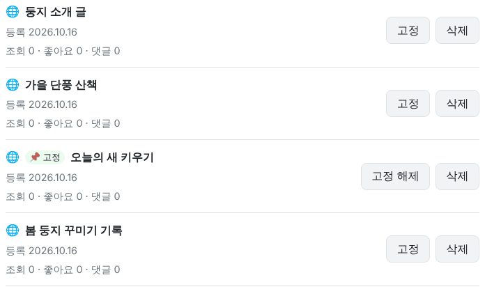
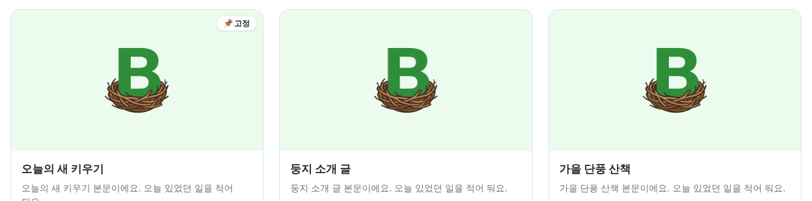
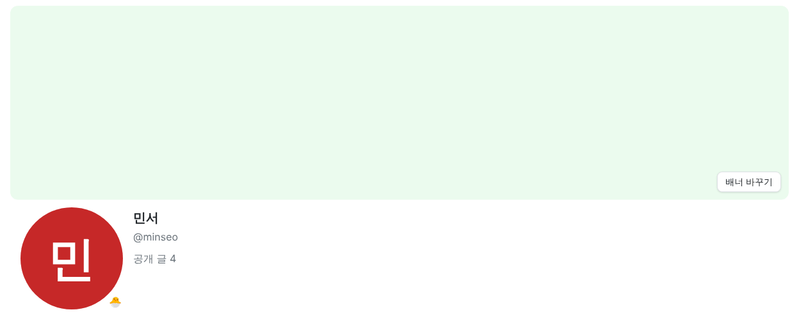
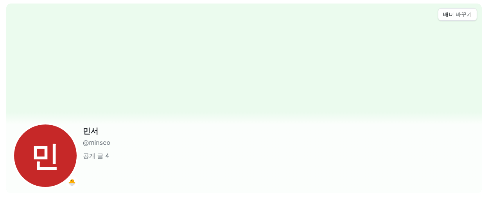

<!-- target: e111646341a31f7c119afb3ce03d597bcff40e41 -->
<!-- title: BaseLOG 1.4.4 배포 이후 수정사항 -->
<!-- date: 2026-10-16 -->

### 글

- 친구 중 최대 3명을 공동 작업자로 골라 글을 함께 고칠 수 있어요. [글 등록]의 등록 설정에서 고르고, 공동 작업자는 등록된 글의 제목과 본문만 고칠 수 있어요. 글에는 "함께 쓴 사람"으로 보이고, 추가된 친구에게 알림이 가요 (#169)
  
  
- 공동 작업자가 있는 글은 나만 보기로 바꿀 수 없어요 (#169)

### 둥지

- 내 글을 둥지 맨 위에 고정할 수 있어요. 내 둥지 관리 > 글에서 [고정]을 누르면 되고, 한 둥지에 3개까지 고정돼요 (#168)
  
  
- PC에서 둥지 배너가 프로필까지 넓게 덮어요. 배너 사진은 5:2(1500×600)로 잘라 올리고, 휴대폰에서는 지금처럼 가로로 긴 띠로 보여요 (#167)
   
