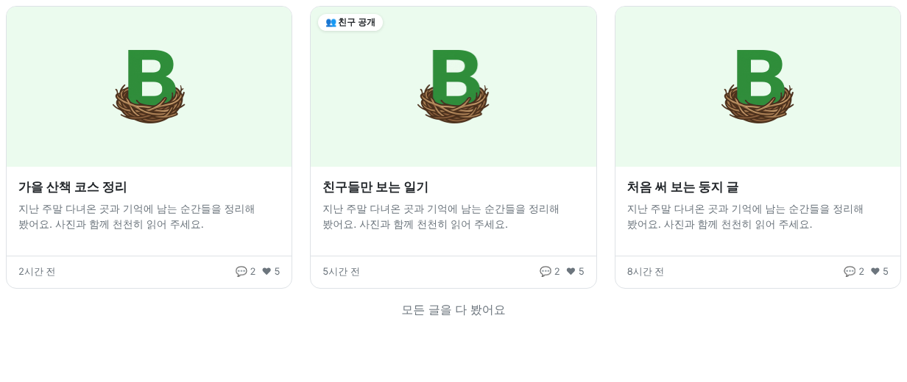
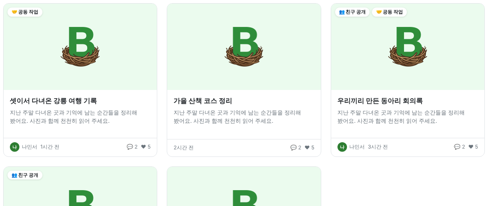
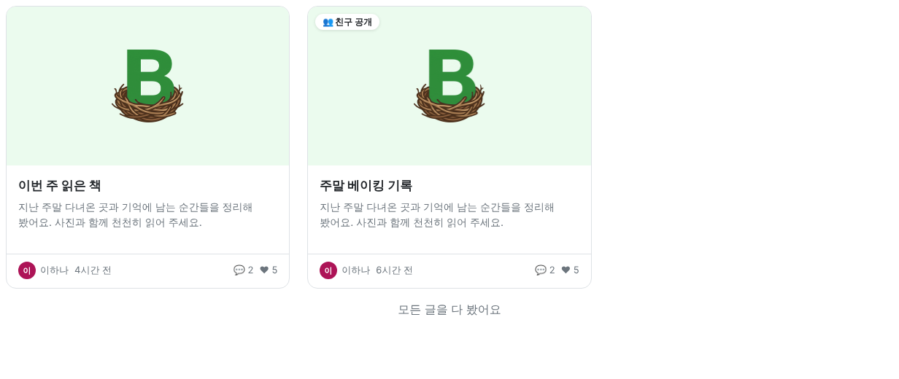
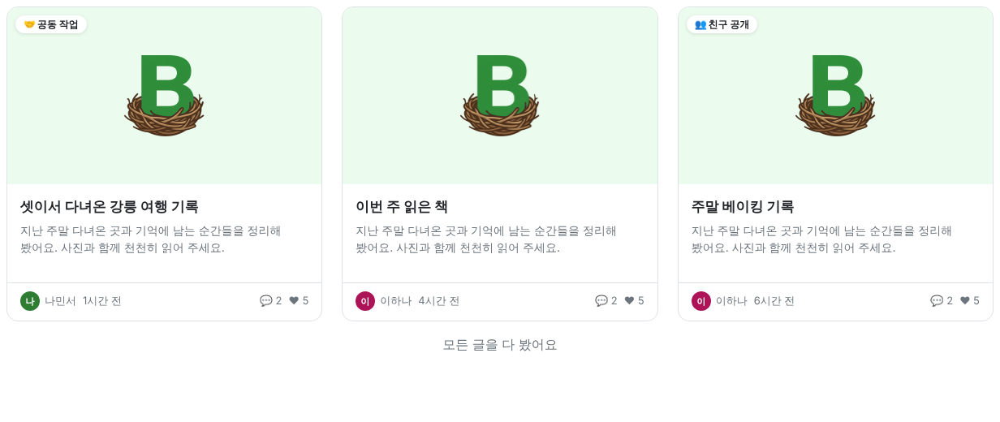
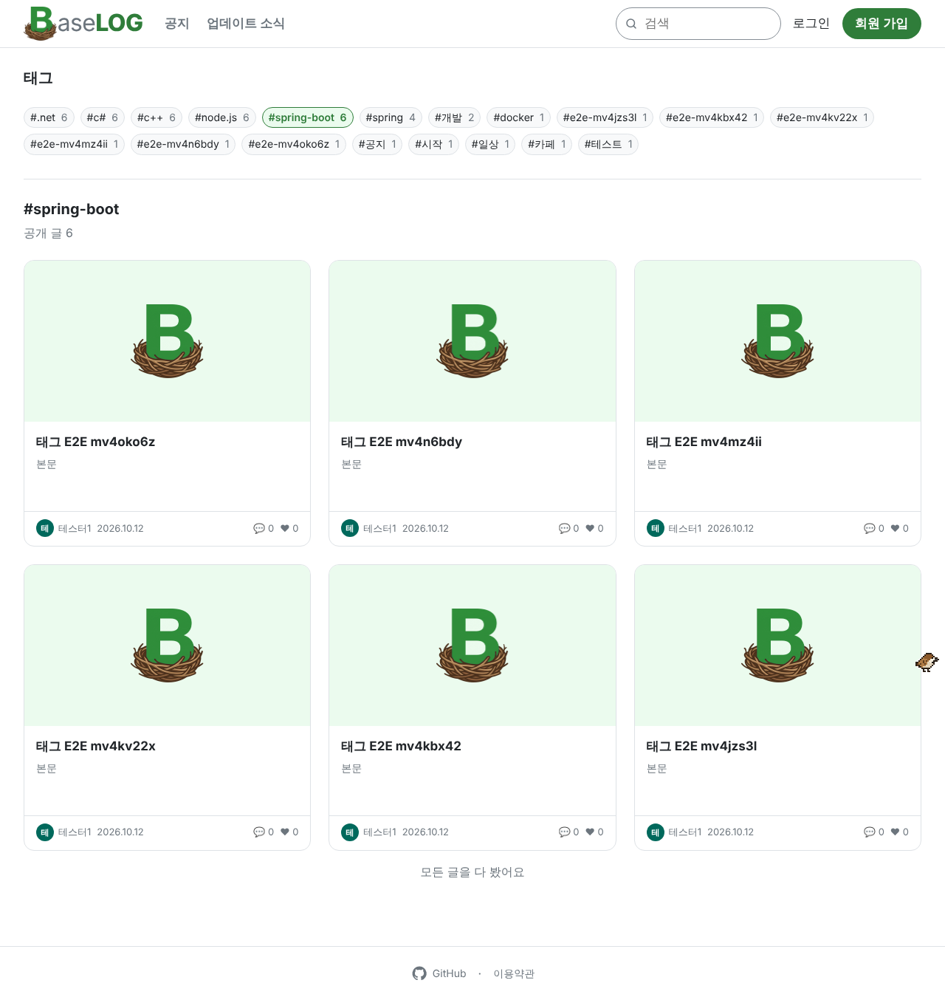

<!-- target: bc59ec76ea23218993fe6577db10e4633cb4f763 -->
<!-- title: BaseLOG 1.5.1 배포 이후 수정사항 -->
<!-- date: 2026-10-19 -->

### 글

- 공동 작업 글은 친구 공개 글처럼 썸네일 왼쪽 위에 "🤝 공동 작업" 표시가 붙어요. 친구 공개 글이면 두 표시가 나란히 보여요 (#176)
- 공동 작업한 글이 함께 쓴 사람의 둥지 목록과, 그 사람 친구들의 친구 피드에도 나와요. 남이 쓴 글이라 카드에 글쓴이가 보이고, 친구 공개 글은 원래대로 글쓴이의 친구에게만 보여요 (#176)
   
   
- 글을 보다가 다른 글 알림을 누르면 그 글이 열려요. 전에는 보던 글로 되돌아갔어요 (#177)

### 태그

- 태그 목록에서 태그를 누르면 페이지 이동 없이 목록 아래에 그 태그 글이 펼쳐져요. 다시 누르면 접혀요 (#178)
  
