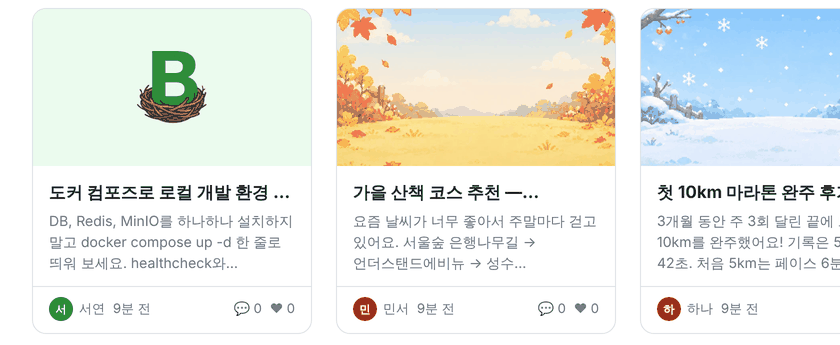
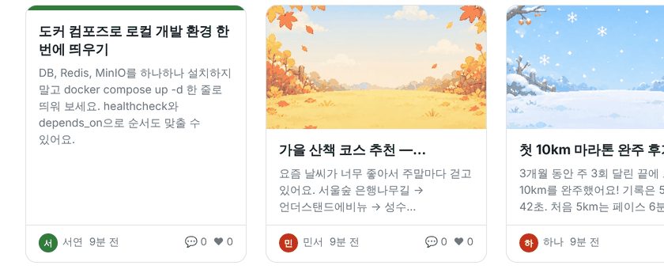
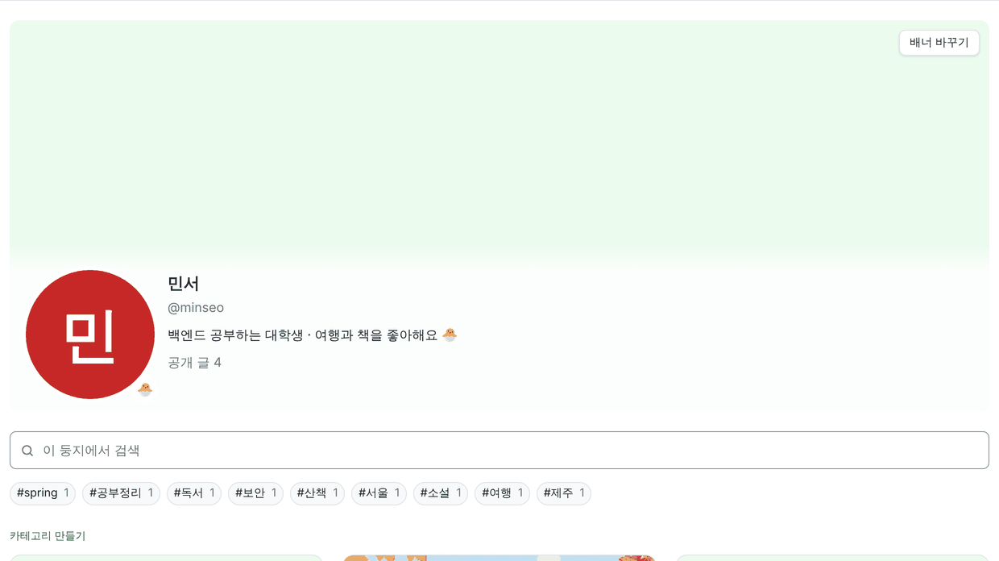
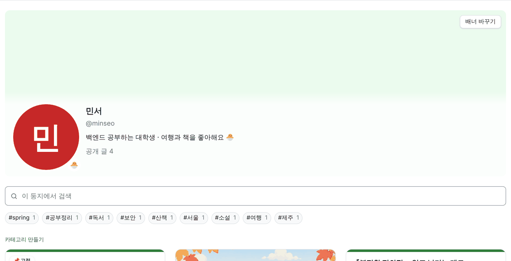
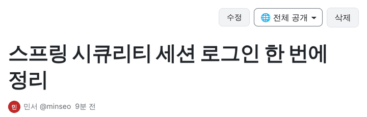
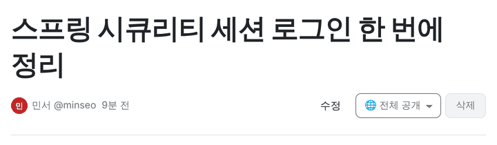
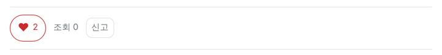
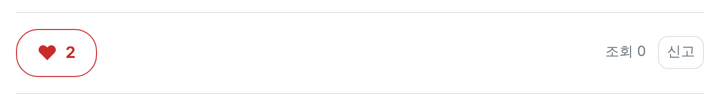
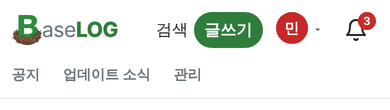
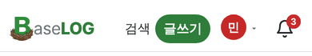

<!-- target: 73b713ad3420538405cdd61cbb23c46b024e8171 -->
<!-- title: BaseLOG 1.5.4 배포 이후 수정사항 -->
<!-- date: 2026-11-25 -->

### 홈·둥지

- 사진이 없는 글은 큰 둥지 그림 대신 위쪽에 초록 띠가 있는 글자 카드로 보여요. 제목은 두 줄, 요약은 더 길게 보여요 (#192)
   
- 홈 맨 위 "최신 글" 제목은 바로 아래 탭과 겹쳐서 뺐어요 (#192)
- PC에서 둥지 배너를 조금 낮춰서 첫 화면에 글이 더 빨리 보여요. 휴대폰에서는 둥지 태그가 한 줄로 모여 옆으로 넘겨 볼 수 있어요 (#192)
   

### 글 읽기

- 내 글의 [수정]·공개 범위·[삭제]가 제목 위가 아니라 글쓴이 줄 오른쪽에 있어요 (#192)
   
- 좋아요 단추가 커졌어요. 댓글 [등록]은 초록 단추예요 (#192)
   

### 머리말

- [공지]·[업데이트 소식]은 맨 아래 꼬리말로 옮겼어요. 관리자의 [관리]는 계정 메뉴의 [관리자 화면]에 있어요. 휴대폰에서 머리말이 한 줄이 됐어요 (#192)
   
